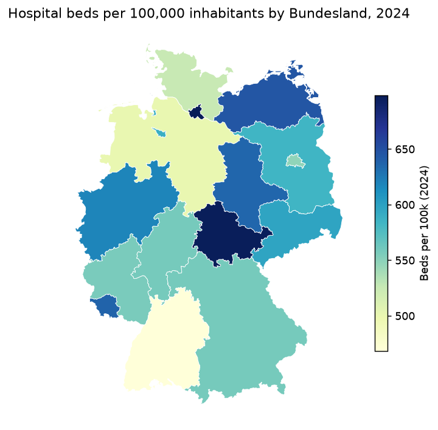

# German Hospital System by Bundesland — Capacity & Utilisation

Reproducible **SQL / ETL / BI** project comparing hospital capacity and utilisation across the
**16 German federal states (Bundesländer)**, 2022–2024, from official **Destatis** statistics —
with a focus on the **Berlin–Brandenburg** pair. One command rebuilds the whole pipeline from
scratch, every number traces to a named source table, and a Power BI model + a cross-platform
HTML preview sit on top. Independent data-analytics portfolio project.



## Key findings (2024, descriptive — not a ranking)

- **Capacity varies ~1.5×** across states: hospital **beds per 100,000** range from **468
  (Baden-Württemberg)** to **698 (Hamburg)** / **697 (Thüringen)**; national average **566**.
- **Utilisation is far more even:** average length of stay **6.6–7.8 days**, bed occupancy
  **68.6–77.8%** (national 72.0%).
- **2022→2024 trend:** hospitals **1,893 → 1,841** (−2.7%) and beds **−1.6%**, while inpatient
  cases recovered to **17.5 M**, lifting occupancy from **69.0% to 72.0%**.
- **Berlin–Brandenburg:** Berlin shows the highest occupancy (77.8%) because its 86 hospitals treat
  patients from Brandenburg (cases are counted at the hospital's location). Read as one region they
  give **562 beds / 20,750 cases per 100k** — see [`reports/analytical_memo.md`](reports/analytical_memo.md).

See the interactive [`reports/dashboard_preview.html`](reports/dashboard_preview.html) (map,
ranking, trends, Berlin–Brandenburg) and the figures in [`reports/figures/`](reports/figures).

## Data sources

| What | Source | Licence |
|---|---|---|
| Hospitals, beds, cases, patient-days, ALOS, occupancy, per-100k | Destatis **statistic 23111** — *Grunddaten der Krankenhäuser*, Statistischer Bericht XLSX, sheet `csv-23111-01` | dl-de/by-2-0 |
| State boundaries (map) | **BKG** VG2500 (Verwaltungsgebiete) | dl-de/by-2-0 |

Exact files, URLs and SHA-256 are recorded in [`data/raw/MANIFEST.json`](data/raw/MANIFEST.json)
(written by the pipeline). The tokenless path needs **no API token**; a free `GENESIS_TOKEN` is an
optional enhancement (adds 2019–2021 by Land). Attribution: **© Statistisches Bundesamt (Destatis)**
and **© BKG (VG2500)**.

## Indicators & definitions

Nine indicators per `Bundesland × year` (full metadata in
[`dashboard/DATA_DICTIONARY.md`](dashboard/DATA_DICTIONARY.md) / `dim_indicator`):
`hospitals`, `beds`, `cases`, `bed_days` (source); `population_avg`, `beds_per_100k`,
`cases_per_100k`, `alos`, `occupancy` (derived).

- **"Fälle" (cases) ≠ unique patients** — one person may be admitted several times — and are
  counted at the **hospital's location**, not patient residence.
- Derived: `alos = bed_days / cases`; `occupancy = bed_days / (beds × days_in_year) × 100`
  (leap years handled). Per-100k **sum numerator and denominator first, then divide** — rates are
  never averaged. `population_avg` is the annual-average population recovered from Destatis's
  published per-100k rates (cross-checked beds-vs-cases).
- **Series break:** population basis changes after **Zensus 2022** (2022+ vs earlier), affecting
  per-100k comparisons across that boundary. **COVID-19** depressed 2020–2022 case counts.

## Architecture

```
Destatis XLSX ──extract──▶ DuckDB raw ──transform(SQL)──▶ staging ─▶ mart ──validate──▶ report
   (idempotent download,        (parse csv-23111-01,     (derived indicators,  (SQL + pandera,
    sha256 + MANIFEST)           special symbols→NaN)     dim_* tables)          spot-checks)
                                                                 │
                                                          export ▼
                               dashboard/data (star-schema CSV) · dashboard/geo (TopoJSON)
                               reports/figures (PNG) · reports/dashboard_preview.html (Plotly)
```

DuckDB warehouse `data/warehouse/hospitals.duckdb`; SQL in [`sql/`](sql); fact
`fact_indicators` (long) + `fact_indicators_wide`, dims `dim_bundesland` / `dim_indicator` /
`dim_year`.

## Quality checks

`python run_etl.py` runs [`reports/validation_report.md`](reports/validation_report.md) and
**fails loudly** on any hard check. All pass: no duplicates; exactly 16 Länder per year; no
negatives; **Σ Länder = Germany total to 0.0000%**; per-100k reproduce published exactly;
**independent ALOS (≤0.01 d) and occupancy (≤0.01 pt) match Destatis**; a pandera schema; and 4
manual spot-checks tracing mart cells back to source XLSX cells.

## Quick start

### macOS / Linux
```bash
python3 -m venv .venv
source .venv/bin/activate
pip install -e ".[dev,geo]"
python run_etl.py
```

### Windows (PowerShell)
```powershell
py -3.14 -m venv .venv
.venv\Scripts\Activate.ps1   # if blocked: Set-ExecutionPolicy -Scope CurrentUser RemoteSigned
pip install -e ".[dev,geo]"
python run_etl.py
```

The `[geo]` extra (geopandas/topojson/matplotlib — wheels only) powers the TopoJSON, map PNG and
HTML preview; omit it and run `python run_etl.py --skip-geo` for the CSV/validation pipeline alone.
Optional token: create a `.env` with `GENESIS_TOKEN=…` (gitignored) —
`export GENESIS_TOKEN=…` (bash) / `$env:GENESIS_TOKEN="…"` (PowerShell).

## Repository layout

```
run_etl.py            config/ (sources.yaml, bundeslaender.csv)   etl/ (extract/transform/validate/export)
sql/ (mart, checks)   data/ (raw+warehouse, gitignored; MANIFEST kept)
dashboard/ (data CSV, geo TopoJSON, DATA_DICTIONARY.md, POWERBI_SPEC.md, screenshots/)
reports/ (validation_report.md, analytical_memo.md, figures/, dashboard_preview.html)
docs/ (PLAN.md, decisions.md, UPDATE_PROCEDURE.md)   tests/
```

Cross-platform: `pathlib` paths, explicit UTF-8, Unicode **NFC** for umlauts, wheels-only deps,
`eol=lf`. **CI** (GitHub Actions) runs ruff + pytest on **ubuntu/windows/macos × Python 3.14**
against synthetic fixtures (no network). Add a year: see
[`docs/UPDATE_PROCEDURE.md`](docs/UPDATE_PROCEDURE.md).

## Power BI

Data model, star-schema CSVs, TopoJSON, ready-to-paste **DAX** and a 5-page build guide are in
[`dashboard/`](dashboard) — **the `.pbix` and screenshots are built by Adele** (Power BI Desktop is
Windows-only; on macOS use a Windows VM). Until then the cross-platform
`reports/dashboard_preview.html` illustrates the same content. `dashboard/screenshots/` — coming soon.

## Limitations

- By-Land years are **2022–2024** (tokenless); a pre-pandemic 2019 by Land needs the GENESIS token
  or the archived Fachserie.
- `population_avg` is Destatis's own denominator recovered from published per-100k, not an
  independent statistic-12411 pull (that is the token enhancement).
- Cases are location-based, not residence-based; no age standardisation. Differences reflect age
  structure, patient flows, hospital mix — **not** care quality.

## Disclaimer

Independent portfolio project. **Not affiliated with** Destatis, BKG or any health authority. No
"best/worst region" rankings. Figures are official Destatis values or documented recomputations.
